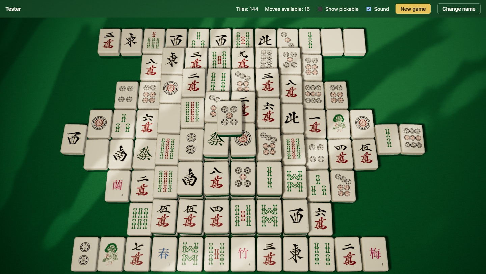

# Mahjong

A relaxed Mahjong solitaire for the browser, with 3D tiles on a green cloth table under a swaying palm-tree shade.

No account and no backend. Type a name and the tiles drop onto the table.



## How to play

- Click a **free** tile to pick it. A tile is free when nothing lies on top of it and its left or right side is open.
- Click a second free tile of the same kind and both are removed. A different kind becomes your new first pick.
- Flowers match any flower, and seasons match any season.
- Clear all 144 tiles to win. **Every deal is guaranteed solvable.**

Turn on *Show pickable* to dim the blocked tiles. Click during the opening deal to skip it.

## Features

- **Real 3D table** (three.js / WebGL2): rounded two-tone tiles, soft lamp lighting, cast shadows and a fabric-shaded cloth.
- **Parallax:** the table tilts gently toward your cursor.
- **Swaying palm shadow** projected over the table and the tiles.
- **Animated opening deal:** tiles drop one by one, with a clack and a puff of cloth dust as each lands. Matched pairs lift away in a burst of sparks.
- **Sound:** recorded tile clacks, varied on every hit, plus pick, match and "blocked" cues, with a mute toggle.
- **Solvable deals:** tiles are placed at random, but along a path that is known to clear the board.
- **Fallback:** a lighter CSS board for browsers without WebGL2.
- **Accessibility:** respects `prefers-reduced-motion` (no drop-in, particles, tilt or sway).

## Getting started

Requires **Node.js 20.19+ or 22.12+**.

```bash
npm install
npm run dev        # dev server with hot reload
```

| Command | What it does |
|---|---|
| `npm run dev` | Start the Vite dev server |
| `npm test` | Run the unit tests once (Vitest) |
| `npm run test:watch` | Run the tests in watch mode |
| `npm run typecheck` | Type-check with `vue-tsc` |
| `npm run build` | Type-check, then build to `dist/` |
| `npm run preview` | Serve the production build locally |

Run a single test file or a single test:

```bash
npx vitest run src/game/game.spec.ts
npx vitest run -t "dealSolvable"
```

The production build is static files in `dist/`, so any static host works. three.js is split into its own chunk and loads while the player types their name.

## Project structure

```
src/
  game/         Pure game logic, no DOM: layout, tile set, solvable dealing, rules, name validation (unit-tested)
  three/        WebGL renderer (three.js): BoardRenderer, face texture atlas
  fx/           Sound (Web Audio) and the 2D particle overlay
  components/   Vue components: name form, 3D board shell, CSS fallback board
public/
  tiles.svg           Tile face sprite
  sounds/             Landing clack samples
  palm-cookie.jpg     Palm shadow texture (1024² crop of palm_shadows.jpg)
```

Some implementation notes:

- **Layout and rules** live in `src/game/`. Positions use half-tile units, so the turtle's offset tiles need no fractions. `dealSolvable` simulates a game in reverse to guarantee a solution.
- **Rendering:** each tile is three instanced meshes sharing one matrix. Faces come from a texture atlas rasterised at runtime from `tiles.svg`, with per-instance atlas cell and highlight state injected into a standard PBR material.
- **Palm shadow:** a spotlight "cookie" (`SpotLight.map`). The sway rolls and shifts the light's shadow camera, so the pattern moves while the tiles' own shadows stay put.

[`CLAUDE.md`](CLAUDE.md) has the detailed architecture notes.

## Contributing

Issues and pull requests are welcome. Before opening a PR:

```bash
npm test && npm run build
```

Keep game rules in `src/game/` with tests. Rendering code should only consume the game state, never decide rules.

## Credits

> **TODO (maintainer):** fill in the source and licence for each asset before publishing.

| Asset | Source | Licence |
|---|---|---|
| `public/tiles.svg` (tile faces) | _TODO_ | _TODO_ |
| `public/sounds/clack-1.mp3`, `clack-2.mp3` | AI-generated (_TODO: tool_) | _TODO: check the tool's terms_ |
| `public/single-mahjong-tile-tap.mp3` | _TODO_ | _TODO_ |
| `public/palm_shadows.jpg` / `palm-cookie.jpg` | _TODO_ | _TODO_ |

Built with [Vue](https://vuejs.org/), [Vite](https://vite.dev/) and [three.js](https://threejs.org/).

## Licence

_TODO: choose a licence (e.g. MIT) and add a `LICENSE` file._ Without one, this code is not open source in the legal sense.
